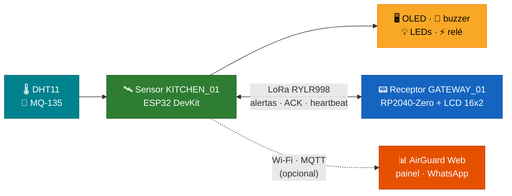
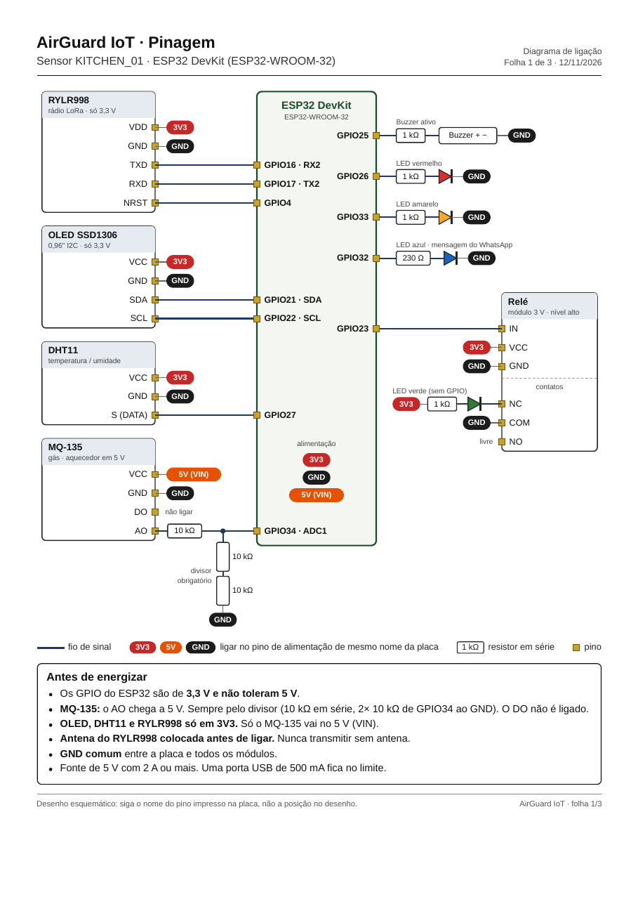
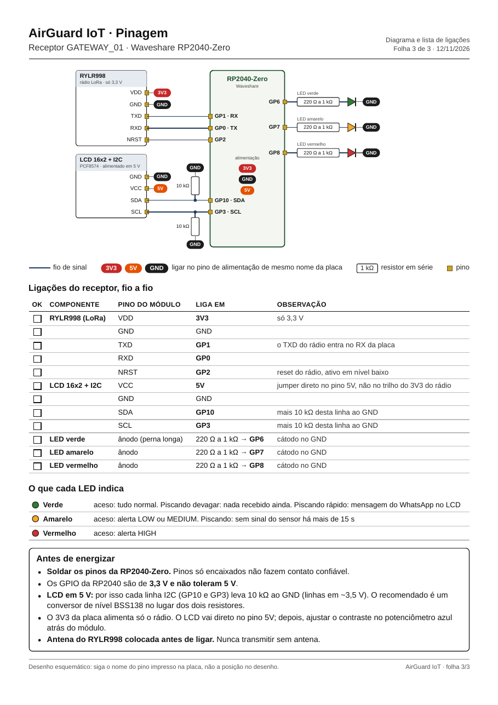

# AirGuard IoT

**SMART ENVIRONMENTAL MONITORING** — *Intelligent monitoring. Safer environments.*

Firmware de monitoramento ambiental de cozinha: um **sensor** (ESP32 DevKit) mede gás, temperatura
e umidade, dispara alertas locais e os transmite por **LoRa** a um **receptor** (RP2040-Zero).
O alarme local funciona **sem Wi-Fi nem internet**; o Wi-Fi é usado só para enviar telemetria ao
painel **AirGuard Web**.

> ⚠️ Protótipo de estudo. **Não é um detector de gás ou de segurança certificado.** O MQ-135 não
> identifica gases nem mede ppm: a tensão do AO é só uma resposta relativa do sensor.

## Sumário

- [Visão geral](#visão-geral)
- [Recursos](#recursos)
- [Pinagem](#pinagem)
- [Início rápido](#início-rápido)
- [Receptor](#receptor-segundo-dispositivo)
- [Estrutura](#estrutura)
- [Documentação](#documentação)
- [Estado atual](#estado-atual)

## Visão geral



## Recursos

- 💨 **Gás** com MQ-135, alarme pela **tensão do AO** (aquecimento, filtro, histerese).
- 🌡️ **Temperatura, umidade e índice de calor** com DHT11.
- 🚦 Alertas **NORMAL / LOW / MEDIUM / HIGH** com persistência temporal e recuperação estável.
- 📡 **LoRa REYAX RYLR998** (comandos AT por UART): envio de alertas com **ACK, timeout de 60 s,
  retransmissão**, fila com prioridade, deduplicação e heartbeat a cada 5 s.
- 💬 **Recebimento de texto** (ex.: mensagens do WhatsApp vindas do AirGuard Web), exibido no OLED
  por **3 s**, com ACK ao remetente.
- 🖥️ **OLED SSD1306** amarelo/azul com prioridade visual, **buzzer** por padrões e **relé** em HIGH.
- 💡 LEDs: 🟢 verde pelo contato NC do relé, 🟡 amarelo e 🔴 vermelho de severidade, 🔵 azul de
  mensagem do WhatsApp.
- 🛡️ Watchdog, persistência em flash, log serial e **console de simulação** para testar todos os
  níveis sem gases reais.

## Pinagem

Legenda: 🔴 3V3 · 🟠 5 V · ⚫ GND · 🔵 sinal. Os números vêm do próprio firmware
(`src/config/hardware_pins.h` e `receiver/src/rx_config.h`). Versão para impressão em A4:
[docs/pinagem/AirGuard-pinagem.pdf](docs/pinagem/AirGuard-pinagem.pdf). Detalhes elétricos:
[docs/01_hardware.md](docs/01_hardware.md).

> ⚡ Os GPIO das duas placas são **3,3 V e não toleram 5 V**. Coloque a **antena do RYLR998 antes
> de ligar** e use **GND comum** entre a placa e todos os módulos.

### Sensor — ESP32 DevKit (ESP32-WROOM-32)



| Módulo | Pino do módulo | Liga em | Observação |
|---|---|---|---|
| 📡 **RYLR998** (LoRa) | VDD | 🔴 3V3 | só 3,3 V |
| | GND | ⚫ GND | |
| | TXD | 🔵 **GPIO16** (RX2) | o TXD do rádio entra no RX da placa |
| | RXD | 🔵 **GPIO17** (TX2) | |
| | NRST | 🔵 **GPIO4** | reset do rádio, ativo em nível baixo |
| 🖥️ **OLED SSD1306** (I2C) | VCC | 🔴 3V3 | só 3,3 V |
| | GND | ⚫ GND | |
| | SDA | 🔵 **GPIO21** | |
| | SCL | 🔵 **GPIO22** | |
| 🌡️ **DHT11** | VCC | 🔴 3V3 | |
| | GND | ⚫ GND | |
| | S (DATA) | 🔵 **GPIO27** | |
| 💨 **MQ-135** | VCC | 🟠 5V (VIN) | aquecedor em 5 V |
| | GND | ⚫ GND | |
| | AO | 10 kΩ → 🔵 **GPIO34** (ADC1) | **divisor obrigatório:** mais 2× 10 kΩ em série do GPIO34 ao GND |
| | DO | — | não ligar |
| 🔔 **Buzzer** | + | 1 kΩ → 🔵 **GPIO25** | − no ⚫ GND |
| 🔴 **LED vermelho** | ânodo | 1 kΩ → 🔵 **GPIO26** | cátodo no ⚫ GND |
| 🟡 **LED amarelo** | ânodo | 1 kΩ → 🔵 **GPIO33** | cátodo no ⚫ GND |
| 🔵 **LED azul** (WhatsApp) | ânodo | 230 Ω → 🔵 **GPIO32** | cátodo no ⚫ GND |
| ⚡ **Relé** (módulo 3 V, nível alto) | IN | 🔵 **GPIO23** | |
| | VCC | 🔴 3V3 | |
| | GND | ⚫ GND | |
| 🟢 **LED verde** | — | 🔴 3V3 → 1 kΩ → LED → **NC** do relé; **COM** → ⚫ GND | sem GPIO: apaga quando o relé arma (HIGH) |

### Receptor — Waveshare RP2040-Zero



| Módulo | Pino do módulo | Liga em | Observação |
|---|---|---|---|
| 📡 **RYLR998** (LoRa) | VDD | 🔴 3V3 | só 3,3 V |
| | GND | ⚫ GND | |
| | TXD | 🔵 **GP1** (RX) | o TXD do rádio entra no RX da placa |
| | RXD | 🔵 **GP0** (TX) | |
| | NRST | 🔵 **GP2** | reset do rádio, ativo em nível baixo |
| 📟 **LCD 16x2 + I2C** (PCF8574) | VCC | 🟠 5V | direto no pino 5V |
| | GND | ⚫ GND | |
| | SDA | 🔵 **GP10** | mais 10 kΩ desta linha ao GND |
| | SCL | 🔵 **GP3** | mais 10 kΩ desta linha ao GND |
| 🟢 **LED verde** | ânodo | 220 Ω a 1 kΩ → 🔵 **GP6** | cátodo no ⚫ GND |
| 🟡 **LED amarelo** | ânodo | 220 Ω a 1 kΩ → 🔵 **GP7** | cátodo no ⚫ GND |
| 🔴 **LED vermelho** | ânodo | 220 Ω a 1 kΩ → 🔵 **GP8** | cátodo no ⚫ GND |

| LED do receptor | Significado |
|---|---|
| 🟢 Verde | aceso: tudo normal. Piscando devagar: nada recebido ainda. Piscando rápido: mensagem do WhatsApp no LCD |
| 🟡 Amarelo | aceso: alerta LOW ou MEDIUM. Piscando: sem sinal do sensor há mais de 15 s |
| 🔴 Vermelho | aceso: alerta HIGH |

Para gerar as folhas de novo depois de mudar um pino: `python3 tools/pinagem.py`.

## Início rápido

Requer [PlatformIO](https://platformio.org/) e, para os testes no PC, `make` e um compilador C++.

```bash
make -C tests                 # testes unitários do sensor no PC (ASan/UBSan)
make -C receiver/tests        # testes do receptor
pio run                       # compilar (ESP32 DevKit + DHT11)
pio run -t upload             # gravar
pio device monitor            # console 115200 → digite "help"
```

Wi-Fi e MQTT (opcionais): copie `src/config/net_secrets.example.h` para
`src/config/net_secrets.h` (ignorado pelo git) e preencha, ou configure pelo console com
`net ssid|pass|broker|user|mqttpass <valor>`. Detalhes em [docs/11_telemetry.md](docs/11_telemetry.md).

## Receptor (segundo dispositivo)

A pasta [`receiver/`](receiver/README.md) contém o **AirGuard Receiver** (RP2040-Zero + RYLR998 +
LCD 16x2 I2C + LEDs verde/amarelo/vermelho). Ele recebe os alertas pelo LoRa, responde com ACK e
mostra o estado. É um projeto PlatformIO próprio (`cd receiver && pio run`).

## Estrutura

```
AirGuard-IoT/
├── platformio.ini
├── src/
│   ├── main.cpp
│   ├── app/            orquestração + console serial
│   ├── config/         config.h (tempos, rádio, políticas), thresholds.h (limites), hardware_pins.h
│   ├── platform/       board.h: única camada com chamadas do ESP-IDF
│   ├── sensors/        MQ-135 (ADC), DHT11
│   ├── monitoring/     cadeia do MQ-135, ambiente, severidade, alertas
│   ├── communication/  protocolo JSON, fila de ACK, driver RYLR998 (AT)
│   ├── display/        lógica de telas, driver OLED, mensagem do WhatsApp na faixa amarela
│   ├── net/            Wi-Fi + MQTT: telemetria e ligação com o WhatsApp (AirGuard Web)
│   ├── actuators/      buzzer, relé, LED
│   └── utils/          log, flash, texto
├── receiver/           AirGuard Receiver (projeto PlatformIO próprio, RP2040-Zero)
├── tests/              testes unitários do nó (Makefile, sem hardware)
├── tools/              console.py (comandos sem reset), trace_air.py (registro do gás), pinagem.py (folhas de pinagem)
└── docs/               documentação (abaixo) e pinagem/
```

Onde mexer no dia a dia: **limites** em `src/config/thresholds.h`, **tempos e políticas** em
`src/config/config.h`, **pinos** em `src/config/hardware_pins.h`.

## Documentação

| # | Documento | Conteúdo |
|---|---|---|
| 01 | [Hardware](docs/01_hardware.md) | componentes, **ligações no ESP32**, pinos evitados, análise elétrica, consumo, pendências |
| 02 | [Arquitetura](docs/02_architecture.md) | módulos, fluxo, máquinas de estado, **bibliotecas e justificativa** |
| 03 | [LoRa e protocolo](docs/03_lora_protocol.md) | **configuração do rádio**, ANATEL, **protocolo e mensagens**, ACK/retransmissão, guia do gateway |
| 04 | [MQ-135](docs/04_mq135.md) | cadeia de sinal, aquecimento, **ajuste dos limites de tensão** |
| 05 | [Limites ambientais](docs/05_environmental_thresholds.md) | **tabela de limites** com referências |
| 06 | [Alertas](docs/06_alerts.md) | **alertas sonoros e visuais**, telas, relé, LED, recuperação |
| 07 | [Plano de testes](docs/07_test_plan.md) | testes unitários + **23 cenários experimentais** |
| 08 | [Limitações](docs/08_limitations.md) | **limitações conhecidas** |
| 09 | [Compilação e gravação](docs/09_build_flash.md) | **compilação**, **gravação**, validação física |
| 10 | [Referências](docs/10_references.md) | **referências técnicas e científicas** |
| 11 | [Telemetria](docs/11_telemetry.md) | ESP32 envia pelo Wi-Fi o que transmite e recebe no LoRa (e o STAT do receptor) para o **painel Ambiente** do AirGuard Web |
| 12 | [WhatsApp](docs/12_whatsapp.md) | **código de conexão no OLED**, mensagens recebidas na faixa amarela e no LCD (LoRa), **avisos de alerta e do relé pelo WhatsApp**, tópicos MQTT |

## Estado atual

| Item | Situação |
|---|---|
| Lógica central (classificação, alertas, protocolo, ACK, rádio AT, telas, texto, WhatsApp) | ✅ 109 testes unitários do sensor + 24 do receptor passando |
| Sensor ESP32 na bancada | ✅ OLED, DHT11, MQ-135 (alarme por tensão), LEDs, buzzer ativo e RYLR998 funcionando |
| Receptor RP2040-Zero | ✅ recebe alertas e heartbeats, envia ACK, LCD funcionando; LEDs ainda não ligados |
| Relé | ⏳ teste de acionamento em HIGH pendente (ver [docs/01_hardware.md §4.4](docs/01_hardware.md)) |
| Testes em hardware (23 cenários) | ⏳ pendentes |
| Pendências de hardware | ver [docs/01_hardware.md §6](docs/01_hardware.md) |

## Licença

Distribuído sob a licença [MIT](LICENSE).
